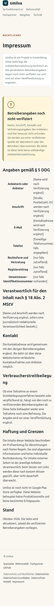
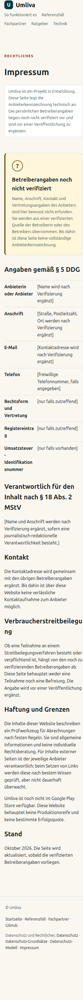

# Impressum: 320-px horizontal overflow repaired — 2026-10-19

Status: **PASS on the locally served candidate.** Live readback follows the
merge and is recorded separately.

## Observed defect

The headed-browser sweep found exactly one horizontal overflow across the
16 published HTML pages at three widths (1366×900, 390×844 and 320×844):

```text
before: 48 page/viewport combinations, 1 problem
320 px /impressum.html  scrollWidth=317  clientWidth=305  overflow=true
all other 47 combinations: no overflow
```

The page could be dragged sideways at the narrow 320-px path used by the
project. Long mandatory labels such as
`Umsatzsteuer-Identifikationsnummer` set the table's min-content width to
301.38 px while only 273 px were available inside the section padding.

## Root cause

`styles.css` had no table rule. The browser therefore sized the table from its
longest unbreakable word, and the table's right edge landed at 317.38 px.

## Fix

Minimal CSS-only change in `styles.css`:

- `table-layout: fixed` and `width: 100%` for tables inside `.section`;
- `overflow-wrap: anywhere` on `th` and `td`;
- a 42 % label column, left-aligned with the existing line colour.

No HTML, copy, claim or navigation changed.

## After

```text
after: 48 page/viewport combinations, 0 problems
320 px /impressum.html  scrollWidth=305  clientWidth=305  overflow=false
390 px /impressum.html  scrollWidth=375  clientWidth=375  overflow=false
1366 px /impressum.html scrollWidth=1351 clientWidth=1351 overflow=false
```

Additional checks in the same run:

- 199 internal links resolved with HTTP 200; 0 broken.
- 23 fragment links resolved to an existing element ID; 0 missing.
- 0 broken images, 0 console errors, 0 failed requests.
- First Tab focuses `.skip-link`; Enter moves focus to `#main-content`.
- All 16 pages report a non-empty title and `h1`.

## Reproduction

```bash
python3 -m http.server 8765 --bind 127.0.0.1   # repository root
python3 docs/evidence/MISSION-2026-10-19/impressum-320/headed_audit.py \
  http://127.0.0.1:8765 /tmp/headed-out
```

Environment: headed Google Chrome launched by Playwright 1.57.0 through the
workstation display (`DISPLAY=:0`), viewport sizes 1366×900, 390×844 and
320×844. No headless-only claim is made. The full per-combination records are
`before-headed.json` and `after-headed.json`; link records are
`after-links.json`.

## Evidence files

Before (320×844):



After (320×844):



- `before-320x844-impressum.png`, `after-320x844-impressum.png`
- `before-headed.json`, `after-headed.json`
- `after-links.json`
- `headed_audit.py`

## Limits

This is layout and link evidence for the local static candidate, not a WCAG
conformance audit and not a live-deployment claim. Deployment and the live
readback are proven after the merge.
